# Track-Flow Database ERD

This ERD reflects the current schema in migrations, including core inventory, traceability, auth/RBAC, and legacy support tables.

```mermaid
erDiagram
    USERS {
        bigint id PK
        string name
        string email UK
        string password
        string phone
        bigint branch_id FK
        timestamp last_login_at
        timestamp created_at
        timestamp updated_at
    }

    BRANCHES {
        bigint id PK
        string name
        string code UK
        string location
        timestamp created_at
        timestamp updated_at
    }

    WAREHOUSES {
        bigint id PK
        bigint branch_id FK
        string name
        string code UK
        enum type
        timestamp created_at
        timestamp updated_at
    }

    PRODUCTS {
        bigint id PK
        string sku UK
        string name
        string unit
        string category
        text description
        timestamp created_at
        timestamp updated_at
    }

    SUPPLIERS {
        bigint id PK
        string name
        string code UK
        string phone
        string email
        text address
        boolean is_active
        timestamp created_at
        timestamp updated_at
    }

    SOURCE_LOTS {
        bigint id PK
        bigint supplier_id FK
        bigint branch_id FK
        string source_lot_code UK
        decimal received_weight_kg
        timestamp received_at
        bigint received_by FK
        string vehicle_number
        string delivery_note_number
        text remarks
        timestamp created_at
        timestamp updated_at
    }

    BATCHES {
        bigint id PK
        bigint product_id FK
        bigint source_lot_id FK
        string batch_code UK
        date manufactured_at
        date expires_at
        timestamp created_at
        timestamp updated_at
    }

    BARCODES {
        bigint id PK
        bigint batch_id FK
        string code UK
        string type
        timestamp generated_at
        timestamp created_at
        timestamp updated_at
    }

    BATCH_STOCKS {
        bigint id PK
        bigint batch_id FK
        bigint warehouse_id FK
        decimal quantity
        timestamp created_at
        timestamp updated_at
    }

    STOCK_TRANSACTIONS {
        bigint id PK
        bigint batch_id FK
        bigint from_warehouse_id FK
        bigint to_warehouse_id FK
        decimal quantity
        enum type
        text reason
        bigint user_id FK
        timestamp created_at
        timestamp updated_at
    }

    PROCESS_STEPS {
        bigint id PK
        string code UK
        string name
        int sequence
        boolean is_active
        timestamp created_at
        timestamp updated_at
    }

    LOT_TRANSFORMATIONS {
        bigint id PK
        string transformation_code UK
        bigint process_step_id FK
        bigint warehouse_id FK
        bigint input_warehouse_id FK
        bigint output_warehouse_id FK
        bigint branch_id FK
        bigint performed_by FK
        timestamp transformed_at
        text remarks
        timestamp created_at
        timestamp updated_at
    }

    LOT_TRANSFORMATION_LINES {
        bigint id PK
        bigint lot_transformation_id FK
        enum line_type
        bigint batch_id FK
        bigint source_lot_id FK
        bigint product_id FK
        decimal weight_kg
        text remarks
        timestamp created_at
        timestamp updated_at
    }

    PASSWORD_OTPS {
        bigint id PK
        string email
        string otp
        timestamp expires_at
        timestamp created_at
        timestamp updated_at
    }

    PERSONAL_ACCESS_TOKENS {
        bigint id PK
        string tokenable_type
        bigint tokenable_id
        string token UK
        text abilities
        timestamp last_used_at
        timestamp expires_at
        timestamp created_at
        timestamp updated_at
    }

    ROLES {
        bigint id PK
        string name
        string guard_name
        timestamp created_at
        timestamp updated_at
    }

    PERMISSIONS {
        bigint id PK
        string name
        string guard_name
        timestamp created_at
        timestamp updated_at
    }

    MODEL_HAS_ROLES {
        bigint role_id FK
        string model_type
        bigint model_id
    }

    MODEL_HAS_PERMISSIONS {
        bigint permission_id FK
        string model_type
        bigint model_id
    }

    ROLE_HAS_PERMISSIONS {
        bigint role_id FK
        bigint permission_id FK
    }

    BARCODE_PRINT_LOGS {
        bigint id PK
        bigint batch_id FK
        bigint printed_by FK
        int copies
        string printer_name
        string reason
        timestamp printed_at
        timestamp created_at
        timestamp updated_at
    }

    AUDIT_LOGS {
        bigint id PK
        bigint user_id FK
        string action
        string auditable_type
        bigint auditable_id
        json old_values
        json new_values
        string ip_address
        string user_agent
        timestamp performed_at
        timestamp created_at
        timestamp updated_at
    }

    STOCKS {
        bigint id PK
        bigint warehouse_id FK
        bigint batch_id FK
        decimal quantity
        timestamp created_at
        timestamp updated_at
    }

    STOCK_MOVEMENTS {
        bigint id PK
        bigint batch_id FK
        bigint from_warehouse_id FK
        bigint to_warehouse_id FK
        enum movement_type
        decimal quantity
        string status
        text remarks
        bigint created_by FK
        timestamp created_at
        timestamp updated_at
    }

    MOVEMENT_APPROVALS {
        bigint id PK
        bigint stock_movement_id FK
        enum status
        bigint approved_by FK
        timestamp approved_at
        text remarks
        timestamp created_at
        timestamp updated_at
    }

    STOCK_SNAPSHOTS {
        bigint id PK
        bigint warehouse_id FK
        bigint batch_id FK
        decimal quantity
        date snapshot_date
        timestamp created_at
        timestamp updated_at
    }

    BRANCHES ||--o{ USERS : has
    BRANCHES ||--o{ WAREHOUSES : has
    BRANCHES ||--o{ SOURCE_LOTS : has
    BRANCHES ||--o{ LOT_TRANSFORMATIONS : has

    SUPPLIERS ||--o{ SOURCE_LOTS : supplies
    USERS ||--o{ SOURCE_LOTS : receives

    PRODUCTS ||--o{ BATCHES : defines
    SOURCE_LOTS ||--o{ BATCHES : seeds
    BATCHES ||--o| BARCODES : identified_by

    BATCHES ||--o{ BATCH_STOCKS : stocked_as
    WAREHOUSES ||--o{ BATCH_STOCKS : stores

    BATCHES ||--o{ STOCK_TRANSACTIONS : moved_in
    WAREHOUSES ||--o{ STOCK_TRANSACTIONS : from_warehouse
    WAREHOUSES ||--o{ STOCK_TRANSACTIONS : to_warehouse
    USERS ||--o{ STOCK_TRANSACTIONS : performed_by

    PROCESS_STEPS ||--o{ LOT_TRANSFORMATIONS : governs
    WAREHOUSES ||--o{ LOT_TRANSFORMATIONS : warehouse
    WAREHOUSES ||--o{ LOT_TRANSFORMATIONS : input_warehouse
    WAREHOUSES ||--o{ LOT_TRANSFORMATIONS : output_warehouse
    USERS ||--o{ LOT_TRANSFORMATIONS : performed_by

    LOT_TRANSFORMATIONS ||--o{ LOT_TRANSFORMATION_LINES : has
    BATCHES ||--o{ LOT_TRANSFORMATION_LINES : referenced_batch
    SOURCE_LOTS ||--o{ LOT_TRANSFORMATION_LINES : referenced_source_lot
    PRODUCTS ||--o{ LOT_TRANSFORMATION_LINES : referenced_product

    USERS ||--o{ PERSONAL_ACCESS_TOKENS : owns

    ROLES ||--o{ MODEL_HAS_ROLES : assigned
    PERMISSIONS ||--o{ MODEL_HAS_PERMISSIONS : assigned
    ROLES ||--o{ ROLE_HAS_PERMISSIONS : grants
    PERMISSIONS ||--o{ ROLE_HAS_PERMISSIONS : included

    BATCHES ||--o{ BARCODE_PRINT_LOGS : printed
    USERS ||--o{ BARCODE_PRINT_LOGS : printed_by

    USERS ||--o{ AUDIT_LOGS : actor

    WAREHOUSES ||--o{ STOCKS : stores_legacy
    BATCHES ||--o{ STOCKS : stock_legacy

    BATCHES ||--o{ STOCK_MOVEMENTS : movement_legacy
    WAREHOUSES ||--o{ STOCK_MOVEMENTS : from_legacy
    WAREHOUSES ||--o{ STOCK_MOVEMENTS : to_legacy
    USERS ||--o{ STOCK_MOVEMENTS : created_by_legacy

    STOCK_MOVEMENTS ||--o{ MOVEMENT_APPROVALS : approval
    USERS ||--o{ MOVEMENT_APPROVALS : approved_by

    WAREHOUSES ||--o{ STOCK_SNAPSHOTS : snapshot
    BATCHES ||--o{ STOCK_SNAPSHOTS : snapshot
```

## Notes

- Primary active inventory ledger in current API logic is `batch_stocks` + `stock_transactions`.
- `stocks`, `stock_movements`, `movement_approvals`, and `stock_snapshots` are legacy/support structures still present in schema.
- Role/permission authorization is polymorphic via Spatie pivot tables (`model_type`, `model_id`), typically targeting `App\Models\User`.

